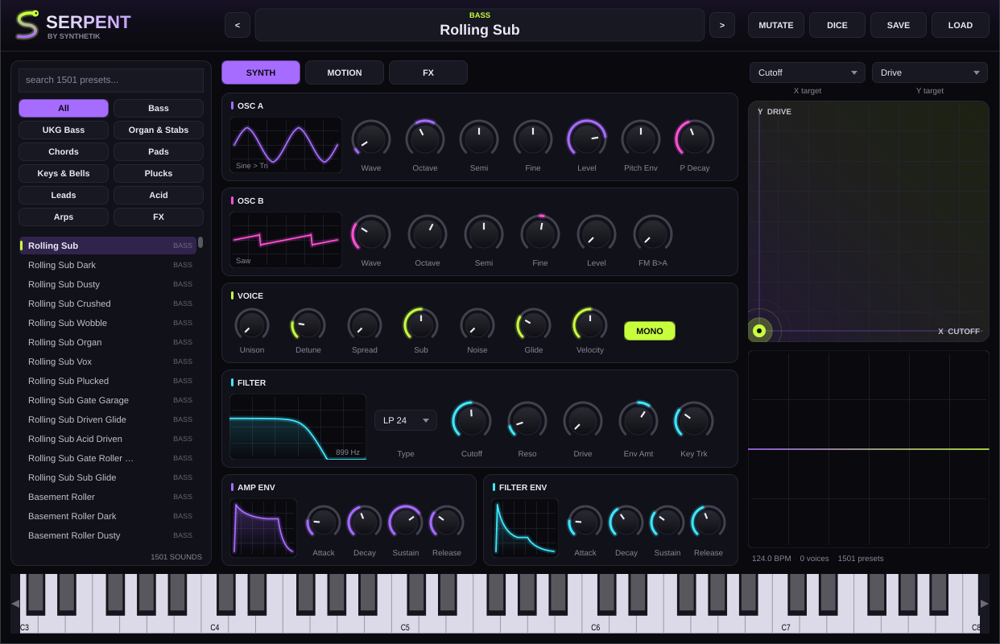

# SERPENT by Synthetik



A house synth built for rolling tech house, UK garage and minimal. It comes with **1,500 presets** in 11 categories, and builds as **VST3**, **AU** and a **standalone app**.

## What's inside

- **Two wavetable oscillators.** Each sweeps smoothly through 8 shapes: Sine, Tri, Saw, Square, Pulse, Organ, Digi (the 90s house organ stab) and Vox. They have up to 7 voices of unison with detune and stereo spread, FM from B into A, a sub and noise.
- **Filter.** LP24, LP12, Band or High, with drive, an envelope, key tracking and a live response display.
- **Envelopes.** Amp, filter and pitch envelopes. The pitch envelope is what gives you zaps, toks and kick-style plucks.
- **LFO.** Tempo-synced, from 4 bars down to 1/16T, or free-running. It can modulate Cutoff, Pitch, Volume, Wave A, Wave B, Pan or FM.
- **XY pad.** Drag it to push two targets that you choose (cutoff, reso, drive, reverb, delay, FM, wave and more). Double-click resets it. Automate it in FL for builds.
- **Trance gate.** 16 steps with 9 one-click patterns (Roller, Garage, Stutter, Offbeat...) and rotate buttons, synced to your project.
- **Arpeggiator.** Up, Down, Up/Down, Random, As Played and Chord modes, over 1–4 octaves.
- **Chord memory.** One finger plays Minor 7, Minor 9, Minor 11, Dub, Fourths and more.
- **FX rack.** Drive (Warm, Hard, Fold, Crush), chorus, tempo ping-pong delay, reverb, Pump (tempo-synced sidechain ducking), low and high cut, and width.
- **MUTATE** nudges the current sound into a fresh variation. **DICE** goes further and scrambles the gate pattern too. **SAVE/LOAD** stores patches in `~/Music/Serpent Patches`.
- **Search box.** Type `dub organ`, `garage reese`, `acid` and so on.

## Preset categories

| Category | Count | | Category | Count |
|---|---|---|---|---|
| Bass | 181 | | Keys & Bells | 130 |
| UKG Bass | 130 | | Plucks | 128 |
| Organ & Stabs | 181 | | Leads | 130 |
| Chords | 104 | | Acid | 78 |
| Pads | 154 | | Arps | 103 |
| FX | 182 | | | |

Every preset is level-matched by an offline render test, so flipping through them doesn't jump in volume.

## Build it on your Mac

This is the same process you used for Dust Box. If you already have Xcode tools, Homebrew and CMake from that, skip to step 3.

1. `xcode-select --install`
2. `brew install cmake`
3. Unzip `Serpent.zip` in Downloads, then run:

```bash
cd ~/Downloads/Serpent
cmake -B build -DCMAKE_BUILD_TYPE=Release
cmake --build build --config Release -j $(sysctl -n hw.ncpu)
```

The first command downloads JUCE, and the second compiles everything, which takes 5–15 minutes. The plugin is copied automatically to:

- `~/Library/Audio/Plug-Ins/VST3/Serpent.vst3` (FL Studio)
- `~/Library/Audio/Plug-Ins/Components/Serpent.component` (Logic and GarageBand)

In FL Studio, go to **Options → Manage plugins → Find installed plugins**, then add Serpent from the Channel Rack.

## Regenerating presets (optional)

`python3 tools/make_presets.py` rebuilds `Source/Presets.h` from the archetypes and modifiers in that script.
